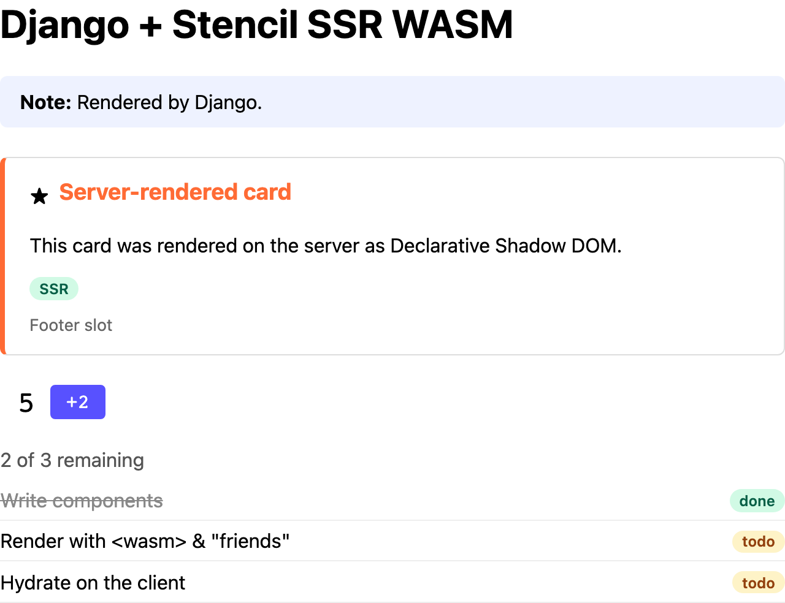
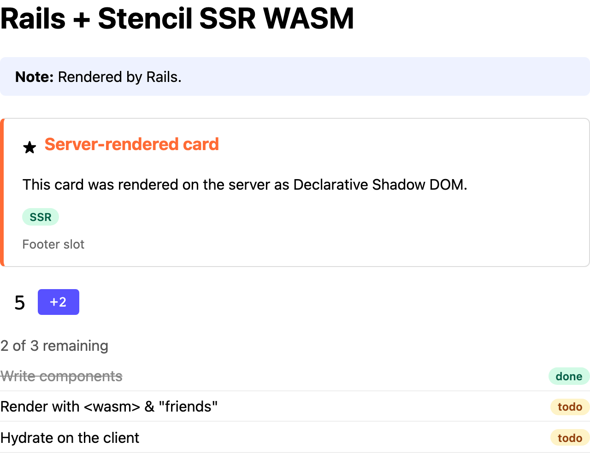
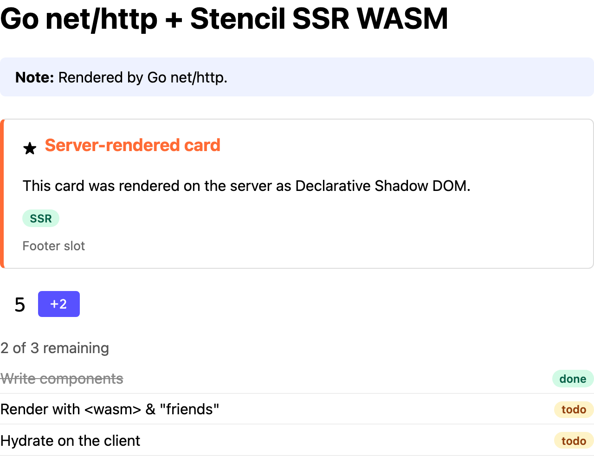
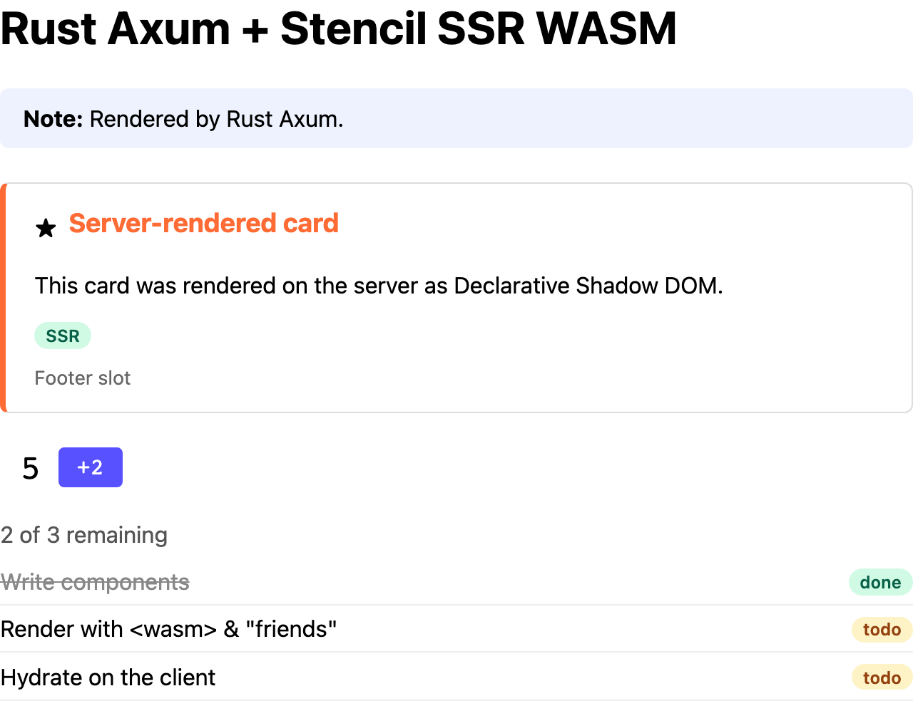
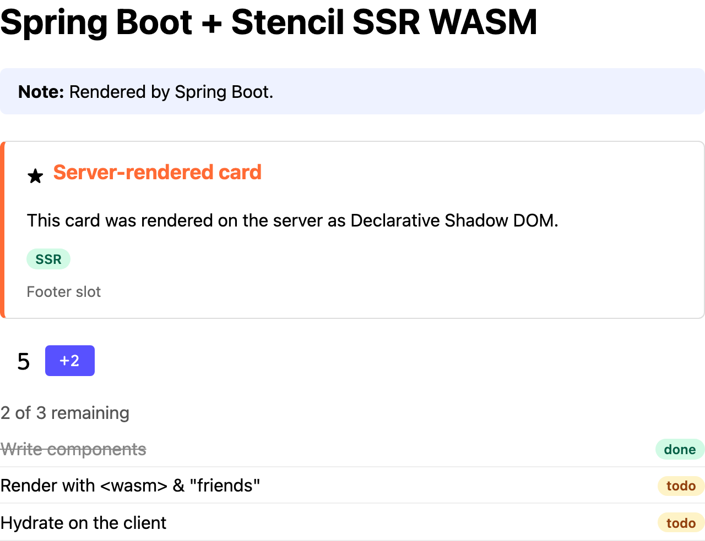
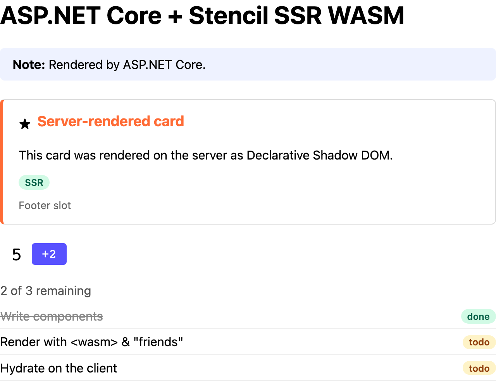

# Stencil `ssr-wasm` examples

Server-side rendering of [Stencil](https://stenciljs.com) web components from languages other
than JavaScript.

Stencil v5's [`ssr-wasm` output target](https://stenciljs.com/docs/ssr-wasm) compiles a
component library's server renderer into a WebAssembly [Extism](https://extism.org) plugin. Any
language with an Extism host SDK can load it and render components to HTML, with Declarative
Shadow DOM, scoped styles and hydration markup, without running Node.js. The browser then
hydrates that HTML with the library's normal client bundle.

This repo has one component library and the same demo app written in several languages, each
using that language's popular web framework:

| Example | Language | Framework | Extism SDK | Port |
|---|---|---|---|---|
| [`examples/php-laravel`](examples/php-laravel) | PHP | Laravel | `extism/extism` (FFI) | 8001 |
| [`examples/python-django`](examples/python-django) | Python | Django | `extism` | 8002 |
| [`examples/ruby-rails`](examples/ruby-rails) | Ruby | Rails | `extism` gem (FFI) | 8003 |
| [`examples/go-nethttp`](examples/go-nethttp) | Go | `net/http` + `html/template` | `extism/go-sdk` (pure Go, wazero) | 8004 |
| [`examples/rust-axum`](examples/rust-axum) | Rust | Axum + MiniJinja | `extism` crate | 8005 |
| [`examples/java-spring`](examples/java-spring) | Java | Spring Boot + Thymeleaf | `org.extism.sdk:extism` (JNA) | 8006 |
| [`examples/dotnet-aspnet`](examples/dotnet-aspnet) | C# | ASP.NET Core (Razor Pages) | `Extism.Sdk` | 8007 |

### Screenshots

**Each screenshot below is a purely server-rendered page, with JavaScript disabled in the
browser.** No client-side code ran: everything you see, including the shadow DOM components and
their styles, is the HTML that language's server sent. When JavaScript is on, the client bundle
hydrates that same markup. The conformance suite checks that hydration separately.

| | |
|---|---|
| [](examples/php-laravel)<br>PHP / Laravel · server-rendered, JavaScript off | [](examples/python-django)<br>Python / Django · server-rendered, JavaScript off |
| [](examples/ruby-rails)<br>Ruby / Rails · server-rendered, JavaScript off | [](examples/go-nethttp)<br>Go / `net/http` · server-rendered, JavaScript off |
| [](examples/rust-axum)<br>Rust / Axum · server-rendered, JavaScript off | [](examples/java-spring)<br>Java / Spring Boot · server-rendered, JavaScript off |
| [](examples/dotnet-aspnet)<br>C# / ASP.NET Core · server-rendered, JavaScript off | |

## Layout

```
packages/components/     the Stencil component library -> dist/ssr-wasm/index.wasm + client bundle
examples/<lang>-<fw>/    one app per language, each with a Dockerfile and README
tests/conformance/       one test suite every example must pass, plus a Node reference server
CONTRACT.md              what every example implements: routes, page markup, plugin lifecycle
```

### Components

Five small components cover the main ways a component can be built:

| Tag | Encapsulation | Shows |
|---|---|---|
| `demo-card` | shadow | named and default slots, `::part`, a reflected variant prop |
| `demo-badge` | scoped | scoped CSS hoisted to `<head>`, nested inside both light and shadow DOM |
| `demo-counter` | shadow | `@State`, `componentWillLoad`, events, client interactivity after hydration |
| `demo-notice` | none | plain light DOM styled by the page's own CSS |
| `demo-task-list` | shadow | a complex (array) prop passed as a JSON attribute, nested components |

### Two integration styles

Every example shows both:

- **Middleware** (`GET /`): the framework renders its page as usual, then a middleware/response
  hook passes the whole HTML document through `renderToString`. This needs the fewest changes to
  an existing app.
- **Template helper** (`GET /helper`): a template tag, filter or helper renders individual
  components with `fullDocument: false` and inlines the result. This gives finer control,
  and the rest of the page never goes through the plugin.

## Getting started

Requirements: Node 22+, pnpm, Docker, and
[`extism-js`](https://github.com/extism/js-pdk#install-the-compiler) on your `PATH` (it's used
to compile the `.wasm`; it also needs Binaryen's `wasm-merge` and `wasm-opt`).

```sh
pnpm install
pnpm build          # builds packages/components -> dist/ssr-wasm/index.wasm + client bundle

# run an example
scripts/docker-build.sh python-django
docker run --rm -p 8002:8002 ssr-wasm-python-django
open http://localhost:8002

# check it
BASE_URL=http://localhost:8002 pnpm test

# or build and check every example
scripts/docker-build.sh && scripts/conformance-all.sh
```

The example images are built with the repo root as context so they can copy in the built
`packages/components/dist`. Run `pnpm build` first. Each example's README also covers running it
without Docker.

If your network uses a TLS-inspecting proxy, set `EXTRA_CA_CERT=/path/to/proxy-root-ca.pem`
before running `scripts/docker-build.sh`. It's passed to the builds as an optional `ca` secret.

## Conformance tests

`tests/conformance` checks each example from the outside:

- **Server HTML** (no JS): every component is rendered, Declarative Shadow DOM and scoped styles
  are present, the complex prop survived the template engine's escaping, hydration IDs are
  unique and start from 1 on every request, and concurrent requests all render correctly.
- **Browser, JS off**: the page is fully rendered and styled before any JavaScript runs.
- **Browser, JS on**: hydration produces no errors and reuses the server markup instead of
  duplicating it, and the components respond to clicks.

```sh
pnpm test                                   # against the Node reference server (started for you)
BASE_URL=http://localhost:8003 pnpm test    # against a running example
ALL_BROWSERS=1 BASE_URL=... pnpm test       # also Firefox and WebKit
```

## Render times

Median time to render each page, from 30 sequential requests on a warm server, in a small Docker
VM (1 CPU, ~2.5 GB). "Plugin" is the time spent in `renderToString`, from the example's
`Server-Timing` header, where it sends one. "End to end" is the whole HTTP response. Treat these as
rough and relative: absolute numbers depend on the hardware. Measured with `@stencil/core`
5.0.0-beta.35, where the plugin reuses one render window across calls
([`reuseWindow`](https://stenciljs.com/docs/ssr#reusewindow)), so each call skips setting up
Stencil's runtime again.

| Example | Extism runtime | `/` plugin | `/` end to end | `/helper` plugin | `/helper` end to end |
|---|---|---|---|---|---|
| PHP / Laravel | wasmtime | | 46 ms | | 59 ms |
| Python / Django | wasmtime | 40 ms | 42 ms | 50 ms | 53 ms |
| Ruby / Rails | wasmtime | | 45 ms | | 57 ms |
| Go / `net/http` | wazero | 133 ms | 135 ms | 162 ms | 164 ms |
| Rust / Axum | wasmtime | 36 ms | 38 ms | 42 ms | 44 ms |
| Java / Spring Boot | wasmtime | 47 ms | 58 ms | 56 ms | 71 ms |
| C# / ASP.NET Core | wasmtime | 36 ms | 38 ms | 47 ms | 51 ms |

The plugin spends most of its time in QuickJS, interpreting the components' JavaScript. That's
why the runtime matters more than the host language: every SDK except Go's runs the plugin on
wasmtime, whose Cranelift compiler produces faster code for the QuickJS interpreter than wazero
does.

## Things to know about `ssr-wasm`

These come from building the examples, and each example's README covers how it handles them:

- **Instances aren't thread-safe.** Compile the module once, and give each worker or thread its
  own plugin instance, or use a pool.
- **Hydration IDs.** Full-document renders always number them from 1. Fragment renders
  (`fullDocument: false`) share one counter in the plugin instance, so the fragments of a page
  never collide. For repeatable output, call `resetSsrDocData` once per request before the first
  fragment. Never call it between fragments on the same page, or their IDs collide.
- **Complex props must be attributes.** The plugin only receives HTML, and function options like
  `beforeSsr` can't cross the JSON boundary. Pass complex props as JSON attributes, and convert
  them in the component with `@AttrDeserialize()` (see `demo-task-list`).
- **Timers run on a virtual clock.** `setTimeout`, `setInterval`, and `requestAnimationFrame` work
  during a render, but nothing waits in real time, and a timer due after the render's `timeout`
  (default 15 s) never fires.
