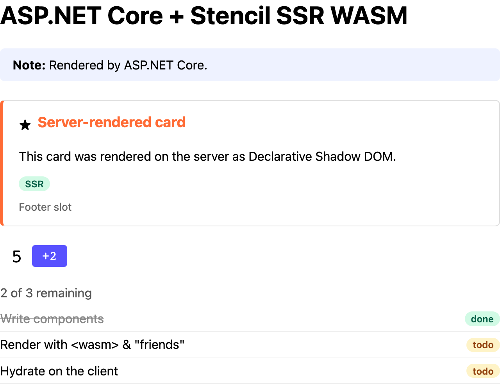

# C# + ASP.NET Core

Server-renders the Stencil components from ASP.NET Core Razor Pages with the
[Extism .NET SDK](https://github.com/extism/dotnet-sdk). Runs on port 8007.



The demo page as this example's server sends it, with JavaScript disabled in the browser.

## Run it

With Docker, from the repo root:

```sh
docker build -f examples/dotnet-aspnet/Dockerfile -t ssr-wasm-dotnet-aspnet .
docker run --rm -p 8007:8007 ssr-wasm-dotnet-aspnet
open http://localhost:8007
```

Behind a TLS-inspecting proxy, pass the proxy's root CA as a build secret:

```sh
docker build --secret id=ca,src=/path/to/proxy-root-ca.pem -f examples/dotnet-aspnet/Dockerfile -t ssr-wasm-dotnet-aspnet .
```

Natively, with the .NET 10 SDK, from this directory:

```sh
dotnet run
dotnet test tests
```

| Env var | Default |
|---|---|
| `SSR_WASM_PATH` | `../../packages/components/dist/ssr-wasm/index.wasm` |
| `STENCIL_CLIENT_DIR` | `../../packages/components/dist/loader-bundle/demo-components` |
| `SSR_POOL_SIZE` | CPU count |

## How it's wired

| File | What it does |
|---|---|
| [`Ssr/SsrRenderer.cs`](Ssr/SsrRenderer.cs) | `SsrRenderer` compiles the plugin once and holds the pool; `SsrHandle` is one request's instance: renders, resets hydration IDs, falls back on errors |
| [`Ssr/StencilSsrMiddleware.cs`](Ssr/StencilSsrMiddleware.cs) | Buffers the response and renders `text/html` as a whole document |
| [`Ssr/StencilTagHelper.cs`](Ssr/StencilTagHelper.cs) | `<stencil>` tag helper: renders its content as a fragment |
| [`Program.cs`](Program.cs) | Registers the services and middleware, serves `/stencil/*` |

This follows the general [How it works](../../README.md#how-it-works) steps. Specific to ASP.NET Core:

- `SsrRenderer` is a singleton. It fills a bounded `Channel<Plugin>` with `SSR_POOL_SIZE`
  instances before the server listens. A request waiting for an instance waits asynchronously.
- `SsrHandle` is a scoped service, so the middleware and every tag helper in a request share one
  instance. It's taken on the first render and returned when the request ends. An instance whose
  call failed or was cancelled is replaced, not reused.
- In a Razor page, wrap a component (or a partial that renders one) in `<stencil>`. Register it
  with `@addTagHelper *, server` (`server` is the assembly name) in [`_ViewImports.cshtml`](Pages/_ViewImports.cshtml):

  ```cshtml
  <stencil><partial name="_DemoTaskList" /></stencil>
  ```

- The middleware skips a page if its handle rendered any fragments, so components aren't
  rendered twice.

## Things to know

- **Add the native runtime package.** `Extism.Sdk` is only bindings; you also need
  `Extism.runtime.<rid>` (or `Extism.runtime.all`). This project picks the SDK's own platform;
  override with `-p:ExtismRuntime=<rid>`.
- **wasmtime needs a writable home.** `libextism` caches compiled code in `$HOME/.cache/wasmtime`.
  If `$HOME` isn't writable, compilation fails. A warm cache cuts compile from seconds to ~100 ms;
  the image fills it at build time with `dotnet server.dll --warm-cache`.
- **`Plugin.Call` is synchronous.** It runs on the request thread. Keep the pool at or below the
  core count so renders can't starve the thread pool.
- **Span results are short-lived.** The `ReadOnlySpan<byte>` overloads point into plugin memory
  and are only valid until the next call on that instance. The `string` overloads copy.
- **Cancellation looks like a timeout.** A cancelled call throws
  `ExtismException: timeout. Exit Code: 134`, same as the manifest timeout. Check
  `RequestAborted` to tell them apart.

## For production, also consider

- Releasing the instance as soon as the page is rendered, before the response is written.
- Streaming non-HTML responses through instead of buffering them.
- A `Server-Timing` header with the time spent in the plugin.

## Performance

Rough numbers from a small Docker VM (1 CPU); see [Performance](../../README.md#performance).

| | |
|---|---|
| Render `/` (middleware, whole document) | ~36 ms (~38 ms end to end) |
| Render `/helper` (reset + 4 fragments) | ~47 ms (~51 ms end to end) |
| Compile (`new CompiledPlugin`): cold / warm wasmtime cache | 2.4-7 s / 95-460 ms |
| Memory, pool of 4: idle / after 16 concurrent requests | ~48 MB / ~68 MB |
