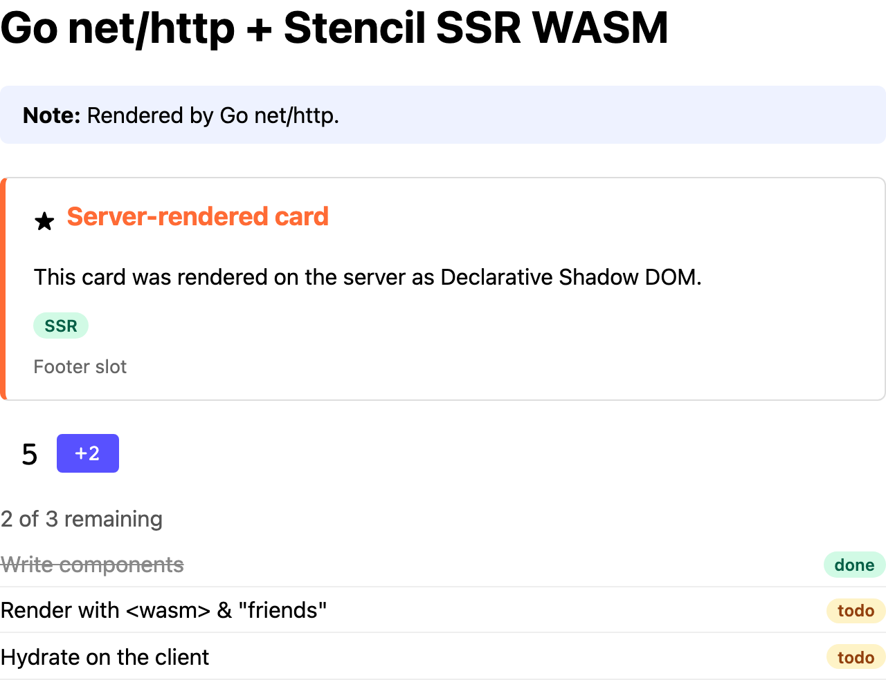

# Go + `net/http`

Server-renders the demo components using only the standard library (`net/http`, `html/template`)
and the pure-Go [Extism SDK](https://github.com/extism/go-sdk), which runs on
[wazero](https://wazero.io). No cgo, so the result is one static binary.



The demo page as this example's server sends it, with JavaScript disabled in the browser.

## Run it

From the repo root (run `pnpm build` first):

```sh
docker build -f examples/go-nethttp/Dockerfile -t ssr-wasm-go-nethttp .
docker run --rm -p 8004:8004 ssr-wasm-go-nethttp
open http://localhost:8004
```

Behind a TLS-inspecting proxy, pass the proxy's root CA as a build secret:

```sh
docker build --secret id=ca,src=/path/to/proxy-root-ca.pem -f examples/go-nethttp/Dockerfile -t ssr-wasm-go-nethttp .
```

Natively, with Go 1.27+, from this directory (default paths point at `packages/components/dist`):

```sh
go run .
```

| Env var | Default |
|---|---|
| `PORT` | `8004` |
| `SSR_WASM_PATH` | `../../packages/components/dist/ssr-wasm/index.wasm` |
| `STENCIL_CLIENT_DIR` | `../../packages/components/dist/loader-bundle/demo-components` |
| `SSR_POOL_SIZE` | `GOMAXPROCS` |

## How it's wired

| File | What it does |
|---|---|
| [`internal/ssr/ssr.go`](internal/ssr/ssr.go) | Compiles the plugin once, holds the instance pool, hands out a per-request `Handle` |
| [`middleware.go`](middleware.go) | `ssrMiddleware`: buffers `text/html` responses and renders the whole document |
| [`pages.go`](pages.go) | The `stencil` template func and the `/helper` handler |
| [`main.go`](main.go) | Config and routes; the middleware wraps only `/` |

- Instances live in a buffered channel of `SSR_POOL_SIZE`, because one instance can't be used
  concurrently. `renderer.Acquire(ctx)` waits for a free one; `h.Release()` puts it back.
- A request keeps its `Handle` for its whole lifetime, so all fragments on a page share one
  instance. The handle calls `resetSsrDocData` before its first fragment.
- In a template, the helper executes a named template from
  [`templates/components.html`](templates/components.html) and renders the result as a fragment:

  ```
  {{stencil .SSR "demo-card" .}}
  ```

- On `__error` or a failed call, `Render` logs and returns the input HTML unchanged.
- Calls run under the request's context, and wazero closes an instance when a call is cancelled.
  After a cancelled or failed call, `Release` replaces the instance in the background, so the
  pool doesn't shrink.
- A render is pure CPU work, so the default pool size is `GOMAXPROCS`, which follows the
  container's CPU limit (Go 1.25+).

## For production, also consider

- wazero's compilation cache (`wazero.NewCompilationCacheWithDir`), pre-filled at image build,
  to skip compiling the module at startup (see Performance).
- An `http.Server` with timeouts and graceful `Shutdown` on SIGTERM.
- A `Server-Timing` header with the time spent in the plugin.

## Performance

Rough numbers from a small Docker VM (1 CPU); see [Performance](../../README.md#performance).

| | |
|---|---|
| Compile (`NewCompiledPlugin`) at startup | 0.8-2.0 s (80-160 ms with a warm compilation cache) |
| Render `/` (middleware, whole document) | ~133 ms |
| Render `/helper` (reset + 4 fragments) | ~162 ms |
| Memory, idle, pool of 1 / pool of 4 | ~45 MB / ~46 MB RSS |
