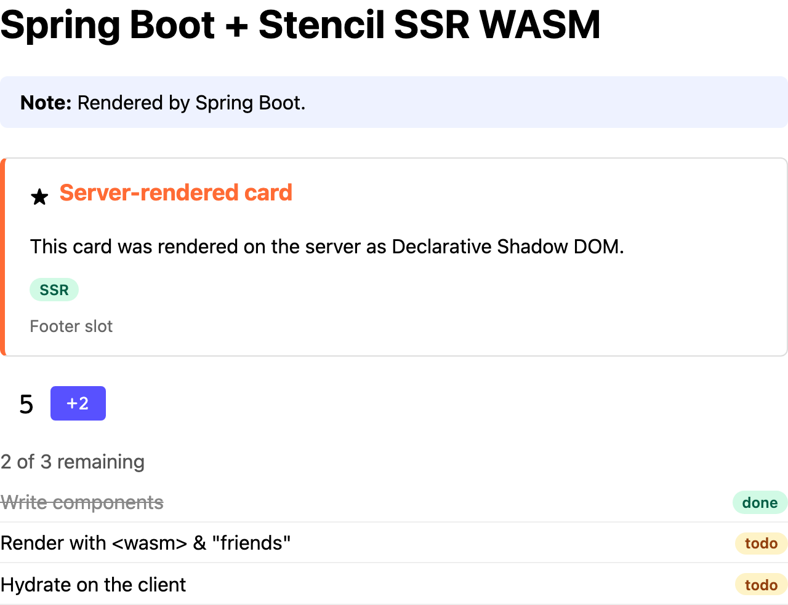

# Java + Spring Boot

Spring Boot 4 (Spring MVC + Thymeleaf) app that server-renders the demo components with the
[Extism Java SDK](https://github.com/extism/java-sdk) (`org.extism.sdk:extism`), which calls
`libextism` (wasmtime) over JNA. Runs on port 8006.



The demo page as this example's server sends it, with JavaScript disabled in the browser.

## Run it

### Docker

Build from the repo root:

```sh
docker build -f examples/java-spring/Dockerfile -t ssr-wasm-java-spring .
docker run --rm -p 8006:8006 ssr-wasm-java-spring
```

Open http://localhost:8006.

Behind a TLS-inspecting proxy, the Maven and libextism downloads fail with `PKIX path building
failed`. Pass the proxy's root CA as a build secret (or set `EXTRA_CA_CERT` when using
`scripts/docker-build.sh`); it's only used during the download steps and isn't stored in any layer:

```sh
docker build --secret id=ca,src=/path/to/proxy-root-ca.pem -f examples/java-spring/Dockerfile -t ssr-wasm-java-spring .
```

Unit tests (they need the plugin and libextism, so they run in the build stage):

```sh
docker build -f examples/java-spring/Dockerfile --target test .
```

### Natively

Requires JDK 25 and `libextism` (`extism lib install` from the
[Extism CLI](https://github.com/extism/cli), or unpack a
[release](https://github.com/extism/extism/releases) into `/usr/local/lib`). From this directory:

```sh
./mvnw spring-boot:run
./mvnw test
```

If libextism isn't on the system library path, tell JNA where it is:
`-Dspring-boot.run.jvmArguments=-Djna.library.path=/path/to/lib` for `spring-boot:run`,
`-DargLine=-Djna.library.path=/path/to/lib` for `test`.

| Env var | Default |
|---|---|
| `PORT` | `8006` |
| `SSR_WASM_PATH` | `../../packages/components/dist/ssr-wasm/index.wasm` |
| `STENCIL_CLIENT_DIR` | `../../packages/components/dist/loader-bundle/demo-components` |
| `SSR_POOL_SIZE` | `availableProcessors()` |
| `JAVA_OPTS` (image only) | `-XX:MaxRAMPercentage=40 -XX:+UseSerialGC --enable-native-access=ALL-UNNAMED` |

Check it against the conformance suite:

```sh
cd tests/conformance && BASE_URL=http://localhost:8006 npx playwright test
```

## Where things are

| Path | What it does |
|---|---|
| [`src/main/java/com/example/stencilssr/ssr/SsrRenderer.java`](src/main/java/com/example/stencilssr/ssr/SsrRenderer.java) | Plugin wrapper: loads the module, owns the instance pool (no Spring dependencies) |
| [`src/main/java/com/example/stencilssr/ssr/SsrHandle.java`](src/main/java/com/example/stencilssr/ssr/SsrHandle.java) | One borrowed instance; `render(html, SsrOptions.DOCUMENT / FRAGMENT)` |
| [`src/main/java/com/example/stencilssr/web/SsrFilter.java`](src/main/java/com/example/stencilssr/web/SsrFilter.java) | Middleware (`/`): servlet filter that renders buffered `text/html` responses |
| [`src/main/java/com/example/stencilssr/web/StencilDialect.java`](src/main/java/com/example/stencilssr/web/StencilDialect.java) | Template helper (`/helper`): Thymeleaf `ssr:render` attribute |
| [`src/main/java/com/example/stencilssr/web/SsrRequest.java`](src/main/java/com/example/stencilssr/web/SsrRequest.java) | Request-scoped bean holding the request's handle for the helper |
| [`src/main/resources/templates/`](src/main/resources/templates/) | `index.html`, `helper.html`, and `components.html` (the component fragments) |
| [`Dockerfile`](Dockerfile) | Multi-stage build: Maven, jlinked JRE, `libextism.so`, AOT and wasmtime cache training run |

## How it uses the plugin

- **Compile once:** the Java SDK has no compiled-plugin type, so each `new Plugin(...)` goes
  through libextism; wasmtime's on-disk cache (`~/.cache/wasmtime`) makes every instance after
  the first load cached machine code instead of recompiling. The Dockerfile fills that cache at build time.
- **Pool:** `SSR_POOL_SIZE` instances in a fair `ArrayBlockingQueue`; `acquire()` waits up to
  30 s, `close()` returns it. Instances aren't thread-safe, and more than one per CPU doesn't help.
- **Per request:** one handle per request. In helper mode the first `ssr:render` acquires it and
  Spring releases it when the request ends.
- **`resetSsrDocData`:** called once per request, before the first fragment, so hydration ids
  start at 1. Whole-document renders don't need it.
- **Errors:** on `{"__error": ...}` or a failed call (trap, 30 s `timeout_ms`), the original HTML
  is returned and the components render on the client. A failed instance is replaced in the background.
- Both routes send a `Server-Timing: ssr;dur=…` header with the time spent in the plugin.

## Things to know

- This uses the libextism SDK, not the pure-JVM [Chicory SDK](https://github.com/extism/chicory-sdk):
  Chicory was about 15x slower on this plugin, even compiled to bytecode.
- libextism needs glibc, so the runtime image is `ubuntu:noble`, not Alpine.
- JNA unpacks a native stub into `~/.cache/JNA`, and wasmtime caches into `~/.cache/wasmtime`, so
  the user needs a writable home directory.
- `--enable-native-access=ALL-UNNAMED` silences Java 24+'s warning about JNA calling `System.load`.
- Don't enable virtual threads: a render is a native call that pins the carrier thread, which on
  1 CPU stalls every other request.
- Plugin instances live outside the Java heap, hence `-XX:MaxRAMPercentage=40`.
- The JVM AOT cache only works with the same JVM and classpath that created it; on a mismatch
  the JVM ignores it. The `[aot] class ... cannot be archived` warnings during the build are harmless.

## Timings

Rough numbers from a small Docker VM (1 CPU); see [Render times](../../README.md#render-times).

| | |
|---|---|
| Startup to "Started", with the AOT cache / without | ~3.0-3.4 s / ~5.8-6.6 s |
| Compile the module (first instance, wasmtime cache empty) | ~3.5 s |
| Instantiate one instance, wasmtime cache warm, incl. first-call init | 130-300 ms |
| Render `/` (middleware, whole document) | ~47 ms |
| Render `/helper` (reset + 4 fragments) | ~56 ms |
| End to end `/` / `/helper` | ~58 ms / ~71 ms |
| First request after startup | ~0.8 s (class loading, JIT) |
| Memory, idle, pool of 1 / pool of 4 | ~136 MB / ~200 MB (~150 MB / ~220 MB after some requests) |
| Image size | ~300 MB |
