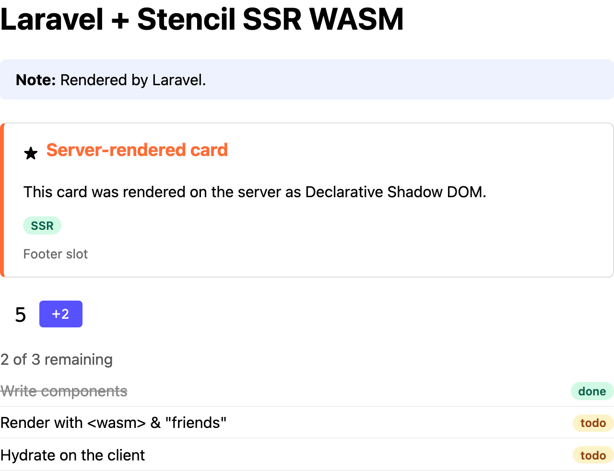

# PHP + Laravel

A Laravel 13 app (PHP 8.4, Octane on FrankenPHP) that server-renders the demo components through
the [Extism PHP SDK](https://github.com/extism/php-sdk) (`extism/extism`), following the steps in
[How it works](../../README.md#how-it-works). Runs on port 8001.



The demo page as this example's server sends it, with JavaScript disabled in the browser.

## Run it

With Docker, building from the repo root:

```sh
docker build -f examples/php-laravel/Dockerfile -t ssr-wasm-php-laravel .
docker run --rm -p 8001:8001 ssr-wasm-php-laravel
# http://localhost:8001/ and http://localhost:8001/helper
```

Behind a TLS-inspecting proxy, pass its root CA as a build secret:
`docker build --secret id=ca,src=/path/to/proxy-ca.pem ...`.

Natively, you need:

- PHP 8.3+ with the `ffi` extension and `ffi.enable=true` in php.ini.
- `libextism.so` (Linux) or `libextism.dylib` (macOS) in `/usr/local/lib` or `/usr/lib`, from
  the [extism/extism releases](https://github.com/extism/extism/releases).
- Composer, and the components built with `pnpm build` at the repo root.

```sh
cd examples/php-laravel
composer install
cp .env.example .env && php artisan key:generate

# Octane + FrankenPHP (recommended). The `frankenphp` binary must be on PATH and its embedded
# PHP needs FFI (check `frankenphp php-cli -m`).
php artisan octane:frankenphp --port=8001

# or, without Octane (one plugin instance per request)
php artisan serve --port=8001
```

| Variable | Default |
|---|---|
| `SSR_WASM_PATH` | `../../packages/components/dist/ssr-wasm/index.wasm` |
| `STENCIL_CLIENT_DIR` | `../../packages/components/dist/loader-bundle/demo-components` |
| `OCTANE_WORKERS` | `2` (Docker only) |

## How it's wired

| File | What it does |
|---|---|
| [`app/Ssr/SsrPlugin.php`](app/Ssr/SsrPlugin.php) | Loads `index.wasm` with WASI; wraps `renderToString` and `resetSsrDocData`; replaces the instance after a call throws. |
| [`app/Ssr/StencilRenderer.php`](app/Ssr/StencilRenderer.php) | Per-request renderer used by both modes; falls back to the input HTML on error. |
| [`app/Http/Middleware/RenderStencilComponents.php`](app/Http/Middleware/RenderStencilComponents.php) | Renders the whole `text/html` response. |
| [`app/Providers/AppServiceProvider.php`](app/Providers/AppServiceProvider.php) | Container bindings and the `@stencil` / `@endstencil` Blade directives. |
| [`config/octane.php`](config/octane.php) | Warms `SsrPlugin` so each worker keeps one instance. |

- One plugin per Octane worker. `SsrPlugin` is a container singleton listed in `warm`, so it
  loads at worker boot and outlives each request (a singleton first resolved inside a request
  would be dropped with it). A worker handles one request at a time, so the instance is never
  shared.
- `StencilRenderer` is `scoped` (new per request) and calls `resetSsrDocData` before the
  request's first fragment.
- In a template, wrap each top-level component (see
  [`helper.blade.php`](resources/views/helper.blade.php)):
  ```blade
  @stencil<demo-task-list tasks="{{ json_encode($tasks) }}"></demo-task-list>@endstencil
  ```
- The middleware is attached only to `/` in [`routes/web.php`](routes/web.php), so helper pages
  are never rendered twice. It only touches `text/html` responses with content, so streamed and
  file responses pass through.

## Things to know

- `ffi.enable=true` must be in php.ini. The default (`preload`) only allows FFI on the CLI, so
  FrankenPHP, PHP-FPM and `artisan serve` fail. A `-d` flag isn't passed to `artisan serve`'s
  child process.
- Octane's auto-downloaded FrankenPHP binary may not have FFI. Check with `frankenphp php-cli -m`.
- The SDK only looks for `libextism` in `/usr/local/lib` and `/usr/lib`.
- Don't use a global named `$lib`: the SDK stores its FFI handle there.
- Errors come back two ways: `{"__error": ...}` JSON in the output, or a thrown
  `Extism\FunctionCallException` on a trap. Handle both, and replace the instance after a trap.
- Use a Blade directive, not a component. A `<x-stencil>` component returning a string would have
  the rendered HTML compiled as Blade again.
- Without Octane the plugin is instantiated on every request (~150 ms with a warm wasmtime cache,
  6-10 s cold). The Dockerfile compiles the plugin once at build time to fill that cache.

## Performance

Rough numbers from a small Docker VM (1 CPU); see [Performance](../../README.md#performance).

| What | Time |
|---|---|
| `GET /`, Octane (1 whole-document render) | ~46 ms |
| `GET /helper`, Octane (4 fragment renders) | ~59 ms |
| Instantiate plugin (warm cache; once per worker) | ~160 ms |
| Compile plugin (cold cache) | 5.8-9.9 s |
| Memory, 2 workers | ~160 MiB |
