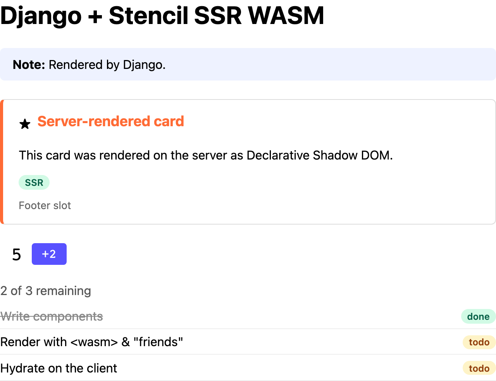

# Python + Django

A Django app that server-renders the demo components with the
[Extism Python SDK](https://pypi.org/project/extism/). Runs on port 8002.



The demo page as this example's server sends it, with JavaScript disabled in the browser.

## Run it

With Docker, from the repo root (run `pnpm build` first):

```sh
docker build -f examples/python-django/Dockerfile -t ssr-wasm-python-django .
docker run --rm -p 8002:8002 ssr-wasm-python-django
```

Open http://localhost:8002.

Natively, with Python 3.12+ and `packages/components/dist` built (the default paths point there):

```sh
cd examples/python-django
python -m venv .venv && . .venv/bin/activate      # or: uv venv && uv pip install -r requirements.txt
pip install -r requirements.txt
gunicorn                                         # reads gunicorn.conf.py; http://localhost:8002
```

| Variable | Default | |
|---|---|---|
| `SSR_WASM_PATH` | `packages/components/dist/ssr-wasm/index.wasm` | the plugin |
| `STENCIL_CLIENT_DIR` | `packages/components/dist/loader-bundle/demo-components/` | browser bundle, served at `/stencil/` |
| `WEB_CONCURRENCY` | 2 | worker processes |
| `GUNICORN_THREADS` | 4 | threads per worker |

## How it's wired

| File | What it does |
|---|---|
| `stencil_ssr/ssr.py` | `Renderer`: compiles once, one instance per thread, renders, falls back on errors |
| `stencil_ssr/middleware.py` | `StencilSSRMiddleware`: renders whole HTML responses (`/`) |
| `stencil_ssr/templatetags/stencil.py` | `…` block tag: renders fragments (`/helper`) |
| `gunicorn.conf.py`, `demo_site/settings.py` | Compiles the plugin in `post_worker_init`; registers the app and middleware |

- Each gunicorn worker compiles the plugin once, after the fork (`preload_app` is off), so
  wasmtime's threads and memory are never forked.
- Each thread gets its own instance (`threading.local`). With `gthread` workers a request stays on
  one thread, so that's safe and caps instances at workers x threads.
- In a template, wrap component markup in the tag. The block is rendered as a normal template
  first, so variables are autoescaped:

  ```django
  
  
  ```

- The tag needs `request` in the template context (use `render(request, ...)`). It calls
  `resetSsrDocData` before the request's first block and marks the request, so the middleware
  skips that response.
- The middleware also skips streaming, non-HTML and compressed responses.
- Errors are handled in one place, `Renderer.render`. On an `__error` result it logs and returns
  the input HTML. If a call traps (`extism.Error`), the thread also drops its instance and creates
  a new one on its next request.

## Things to know

- The cache dir must be writable. Extism keeps wasmtime's compilation cache under `$HOME/.cache`,
  so run the app as a user with a writable home. As `nobody`, compilation fails with
  `Permission denied`. The Dockerfile compiles the plugin once at build time to warm this cache.
- `extism` 1.1.1 doesn't export `CompiledPlugin` from the package root. Import it from
  `extism.extism`.
- Sync views only. Per-thread instances rely on a request never changing threads. Async views or
  streaming responses would need a pool instead.
- The SDK releases the GIL during a call, so threads render in parallel. Scale further with
  `WEB_CONCURRENCY`.
- Complex props: the view passes `json.dumps(tasks)` to `tasks="{{ tasks_json }}"`, and Django's
  autoescaping handles the quoting.
- The browser bundle is served by WhiteNoise, so it works with `DEBUG` off.

## For production, also consider

- A `Server-Timing` header or metrics for time spent in the plugin.
- Logging error-level `diagnostics` even when a render succeeds.

## Performance

Rough numbers from a small Docker VM (1 CPU); see [Performance](../../README.md#performance).

| | |
|---|---|
| Compile module, once per worker | several seconds cold, 0.3–1.1 s with a warm cache |
| Instantiate plugin, once per thread | 0.4–50 ms |
| Render `/` (one full-document call) | ~40 ms (~42 ms end to end) |
| Render `/helper` (four fragment calls) | ~50 ms (~53 ms end to end) |
