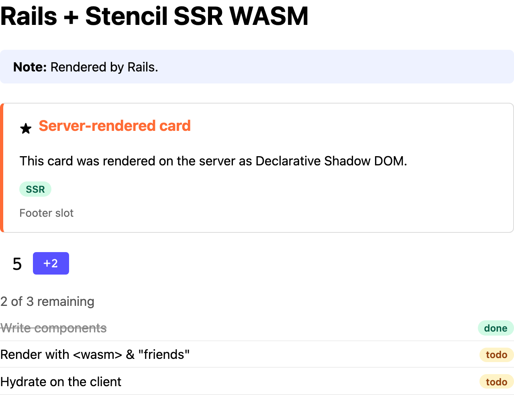

# Ruby + Rails

A minimal Rails 8.1 app (Ruby 3.4, Puma, no database or asset pipeline) that server-renders
Stencil components with the `ssr-wasm` plugin, using the
[Extism Ruby SDK](https://github.com/extism/ruby-sdk). It runs on port 8003.



The demo page as this example's server sends it, with JavaScript disabled in the browser.

## Run it

### Docker

From the repo root (the build needs `packages/components/dist`):

```sh
docker build -f examples/ruby-rails/Dockerfile -t ssr-wasm-ruby-rails .
docker run --rm -p 8003:8003 ssr-wasm-ruby-rails
open http://localhost:8003/ http://localhost:8003/helper
```

### Natively

Needs Ruby 3.3+ and libextism on the library path: download `libextism-<target>-<version>.tar.gz`
from the [Extism releases](https://github.com/extism/extism/releases) and copy `libextism.so` /
`libextism.dylib` to `/usr/local/lib`. Run `pnpm build` at the repo root first; the default
paths point into `packages/components/dist`.

```sh
cd examples/ruby-rails
bundle install
bundle exec puma -C config/puma.rb                       # development
RAILS_ENV=production bundle exec puma -C config/puma.rb  # production
```

Conformance tests:

```sh
cd tests/conformance && BASE_URL=http://localhost:8003 npx playwright test
```

### Environment

| Variable | Default | |
|---|---|---|
| `PORT` | 8003 | |
| `RAILS_MAX_THREADS` | 3 | Puma threads, and the pool size per process. |
| `WEB_CONCURRENCY` | 0 | Puma workers (0 = single process). |
| `RAILS_LOG_LEVEL` | `info` | `debug` logs every render's timing. |
| `SSR_WASM_PATH` | | Path to the `.wasm`. |
| `STENCIL_CLIENT_DIR` | | Client bundle, served at `/stencil/*`. |

## Where things are

| File | |
|---|---|
| [`lib/stencil_ssr/renderer.rb`](lib/stencil_ssr/renderer.rb) | Plugin wrapper: `reset!` (`resetSsrDocData`) and `render` (`renderToString`, with the `__error` fallback). |
| [`lib/stencil_ssr/compiled_plugin.rb`](lib/stencil_ssr/compiled_plugin.rb) | Compile once, instantiate many (FFI binding; see below). |
| [`lib/stencil_ssr/session.rb`](lib/stencil_ssr/session.rb) | Per-request: checks out an instance and renders the document or fragments. |
| [`lib/stencil_ssr/middleware.rb`](lib/stencil_ssr/middleware.rb) | Middleware (`/`): renders `text/html` responses, returns the instance to the pool. |
| [`app/helpers/stencil_helper.rb`](app/helpers/stencil_helper.rb) | Helper (`/helper`): `<%= stencil do %> … <% end %>`. |
| [`lib/stencil_ssr.rb`](lib/stencil_ssr.rb) | Config, the compiled plugin, the instance pool, boot-time warm-up. |
| [`config/application.rb`](config/application.rb) | Paths and `config.middleware.use StencilSsr::Middleware`. |
| [`config/puma.rb`](config/puma.rb) | Threads, workers, warm-up hooks. |
| [`app/views/pages/`](app/views/pages/) | `middleware.html.erb` and `helper.html.erb`. |

## How it uses the plugin

- **Compile once per process**, after Puma forks. `after_booted` / `before_worker_boot` in
  `config/puma.rb` warm it up at boot so no request pays for it.
- **Instances live in a [`connection_pool`](https://github.com/mperham/connection_pool)** sized to
  `RAILS_MAX_THREADS`. Instances aren't thread-safe; the pool scopes one to a request, caps the
  count and drops instances inherited across `fork`.
- **One instance per request.** The first render checks it out; the middleware checks it back in
  (in an `ensure`). Requests that render nothing (`/health`, `/stencil/*`) never take one.
- **`resetSsrDocData`** is called once per request, before the first fragment. Full-document
  renders need no reset.
- **On `__error`**, the un-rendered HTML is returned and the error is logged. An instance whose
  call raised (a trap) is discarded instead of returned to the pool.

## Things to know

- **The Ruby SDK has no compile-once API.** `extism` 1.0.1 only has
  `Extism::Plugin.new(wasm, wasi: true)`, which compiles the module per instance (~7.4 s).
  `StencilSsr::CompiledPlugin` binds libextism's `extism_compiled_plugin_new` +
  `extism_plugin_new_from_compiled` with FFI and wraps the result in a normal `Extism::Plugin`.
  Switch to an SDK API if one is added.
- **Calls hold the GVL.** The SDK's FFI calls don't release it, so threads in one process render
  one at a time. For parallel rendering use workers (`WEB_CONCURRENCY=N`); each builds its own
  pool. Total instances = workers x threads, each with its own memory.
- **Output is binary.** `Plugin#call` returns an `ASCII-8BIT` string; `Renderer#render` forces it
  to UTF-8.
- **Middleware position.** `config.middleware.use` puts it after `ActionDispatch::Static` and
  inside `Rack::ETag`, so static files skip it and ETags cover the rendered HTML. Responses that
  used the `stencil` helper are left alone, so components aren't rendered twice.
- **JSON props.** `tasks="<%= @tasks.to_json %>"` works as is: ERB escapes the attribute, and
  Active Support's `<` / `>` / `&` escapes are undone by the component's `JSON.parse`.

## Timings

Rough numbers from a small Docker VM (1 CPU); see [Render times](../../README.md#render-times).
Production mode, one Puma process, 3 threads.

| | |
|---|---|
| Compile the plugin (once per process, at boot) | ~6.7-7.4 s |
| Instantiate from the compiled plugin (per pool slot) | 5-9 ms |
| `Extism::Plugin.new` instead (compile + instantiate, per instance) | ~7.4 s |
| `GET /`: one whole-document `renderToString` | ~45 ms end to end |
| `GET /helper`: four fragment renders | ~57 ms end to end |
| Memory, `WEB_CONCURRENCY=2` after the conformance suite | ~265 MiB in total |
