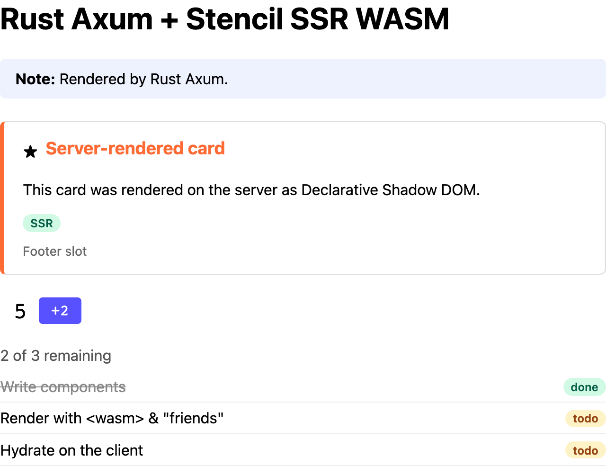

# Rust + Axum

The demo app in [Axum](https://github.com/tokio-rs/axum) with [MiniJinja](https://github.com/mitsuhiko/minijinja)
templates, rendering components with the [Extism Rust SDK](https://github.com/extism/extism/tree/main/runtime) (wasmtime). Port 8005.



The demo page as this example's server sends it, with JavaScript disabled in the browser.

## Run it

With Docker, from the repo root:

```sh
docker build -f examples/rust-axum/Dockerfile -t ssr-wasm-rust-axum .
docker run --rm -p 8005:8005 ssr-wasm-rust-axum
open http://localhost:8005
```

The first build takes about 25 minutes on one CPU, mostly compiling wasmtime. Behind a TLS-inspecting proxy, pass the proxy's root CA as a build secret:

```sh
docker build --secret id=ca,src=/path/to/proxy-root-ca.pem -f examples/rust-axum/Dockerfile -t ssr-wasm-rust-axum .
```

Natively, with Rust 1.96+ and `pnpm build` run at the repo root. From this directory:

```sh
cargo run --release
```

Use `--release`: a debug build of wasmtime compiles the plugin very slowly.

| Env var | Default |
|---|---|
| `PORT` | `8005` |
| `SSR_WASM_PATH` | `../../packages/components/dist/ssr-wasm/index.wasm` |
| `STENCIL_CLIENT_DIR` | `../../packages/components/dist/loader-bundle/demo-components` |
| `SSR_POOL_SIZE` | number of CPUs |
| `SSR_CACHE_CONFIG` | unset (no compilation cache) |
| `EXTISM_ENABLE_WASI_OUTPUT` | unset (plugin output discarded) |

## How it's wired

| File | What it does |
|---|---|
| [`src/ssr.rs`](src/ssr.rs) | `Renderer` (compiled plugin + instance pool) and a per-request `Session` |
| [`src/middleware.rs`](src/middleware.rs) | `ssr_middleware`: renders the whole HTML response on `/` |
| [`src/pages.rs`](src/pages.rs) | The `stencil` MiniJinja filter and the page handlers |
| [`src/main.rs`](src/main.rs) | Builds the `Renderer` and adds the middleware to `/` only |

- The module is compiled once with `CompiledPlugin`. A `Plugin` runs one call at a time, so `Renderer` keeps `SSR_POOL_SIZE` instances in a `tokio::sync::mpsc` channel. A request waits asynchronously for one, up to 30 s; after that `/` and `/helper` both return `503`.
- `Renderer::run` hands a `Session` to a closure on `spawn_blocking`, since renders are blocking CPU work. Dropping the session puts the instance back.
- On `/helper` the whole template renders inside one `run`, so every fragment uses the same instance. `render_fragment` calls `resetSsrDocData` before the session's first fragment:

  ```rust
  renderer.run(move |session| {
      let ssr = Value::from_dyn_object(Arc::new(SsrSession(Mutex::new(session))));
      pages.render("helper.html", Some(ssr))
  })
  ```

- In the template, wrap each component in the filter:

  ```jinja
  
  ```

  MiniJinja escapes the block body as usual, then the filter renders it with `{"fullDocument": false}` and returns it as safe HTML.
- The middleware is a `route_layer` on `/` only, so `/helper` never passes through it.
- On `__error` or a failed call, the page gets the unrendered HTML. A call that traps or times out (30 s) marks the instance broken, and the session replaces it when dropped.

## For production, also consider

- A `Server-Timing` header or metrics for time spent in the plugin.
- Replacing a broken instance in the background instead of on the request that broke it.
- Skipping `HEAD`, `204`/`304` and other non-200 responses in the middleware, and capping the buffered body size.

## Things to know

- Always set a cache config. By default Extism uses a wasmtime cache in `~/.cache/wasmtime` and fails to compile if it can't create that directory. `Renderer::new` uses `SSR_CACHE_CONFIG` if set, otherwise disables the cache. Use a TOML file like [`wasmtime-cache.toml`](wasmtime-cache.toml): Extism overwrites any `cache` set through `with_wasmtime_config`.
- The cache saves 2-4 s of startup. The image fills it at build time with `server --warm-cache`.
- Plugin stdout/stderr are discarded unless `EXTISM_ENABLE_WASI_OUTPUT` is set. The image sets it, so component `console.*` output shows in `docker logs`.
- `extism::Pool` blocks the thread while it waits for an instance, which stalls a tokio worker. That's why this example uses its own channel-based pool.
- `Plugin::call` takes `&mut self` and fails with "cannot make reentrant calls into plugin" if the instance is busy, so give each instance one owner at a time.
- The SDK's default features include an HTTP client the plugin doesn't need. This example uses `default-features = false, features = ["register-filesystem", "wasmtime-default-features"]`; `register-filesystem` is needed for `Wasm::file`.

## Performance

Rough numbers from a small Docker VM (1 CPU); see [Performance](../../README.md#performance).

| | |
|---|---|
| Render `/` (middleware, whole document) | ~36 ms (~38 ms end to end) |
| Render `/helper` (reset + 4 fragments) | ~42 ms (~44 ms end to end) |
| Compile, no cache / wasmtime cache warm | 2.1-3.6 s / 70-100 ms |
| Memory, idle, pool of 1 / pool of 4 after 16 concurrent requests | ~17-20 MB / ~30 MB |
